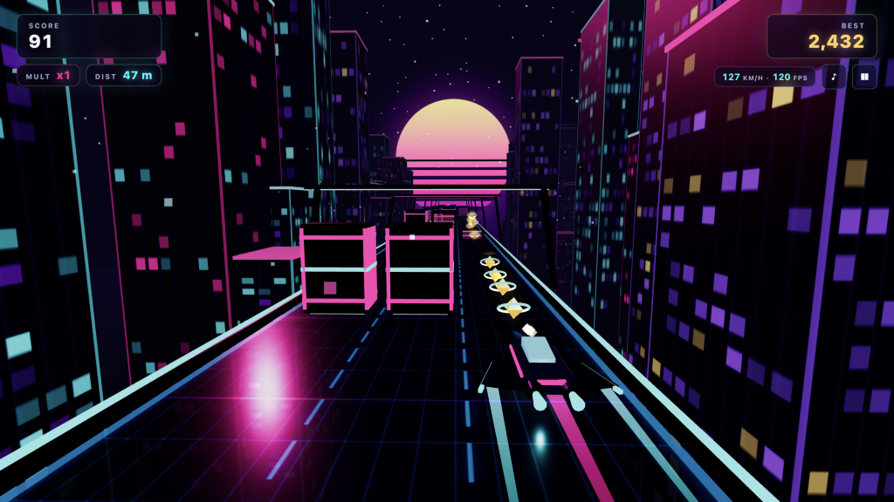

# NEON DRIFT

> **Thread the elevated cyber-skyway at terminal velocity.** A 3D cyberpunk/synthwave endless runner built entirely with procedural Three.js visuals and Web Audio synthesis—zero external models, textures, or audio files.



## Key Features

- **100% Procedural Cyberpunk / Synthwave 3D World**: Suspended glass-and-neon skyway with a canvas-generated cyan/magenta grid, overhead gantry arches, towering skyscraper silhouettes with lit cyber-windows, a segmented retro synthwave sun, starfield, speed particles, and atmospheric `FogExp2`.
- **Responsive Hover-Craft & Smooth 3-Lane Physics**: Fluid horizontal lane interpolation with dynamic banking/pitching, crisp jump physics, crouch/slide with mid-air quick-drop, and zero-allocation neon ribbon wingtip trails.
- **Tactical Obstacles & Guiding Orbs**:
  - **Low Energy Barriers** — leap over along golden orb jump arcs.
  - **High Laser Gates** — slide underneath along low-altitude orb lines.
  - **Full-Lane Neon Monoliths** — weave smoothly into open lanes.
- **Power-Ups & Combo Multiplier**:
  - **Shield (`◈`)** — projects a translucent energy dome that absorbs one crash impact.
  - **Orb Magnet (`◎`)** — pulls nearby energy orbs straight into your hover-craft.
  - Consecutive orb streaks scale your score multiplier up to **x10**.
- **Progressive Speed & Dynamic Camera**: Speed steadily ramps up over each run while camera FOV subtly widens (`64°` → `82°`) to amplify the sense of velocity.
- **Pure Web Audio API Synthesizer**: Real-time synthesized lane-switch whooshes, jump/slide sweeps, pentatonic orb chimes, power-up chords, shield shatters, sub-bass crash impacts, and a toggleable speed-reactive synthwave bassline pulse.
- **Minimal Futuristic HUD & Persistence**: Glassmorphism HUD showing Score, Multiplier, Distance, Speed (`KM/H`), live `FPS`, active power-up indicators, and automatic High Score persistence via `localStorage`.

## Controls

| Action | Keyboard | Touch |
| :--- | :--- | :--- |
| **Switch Left** | `A` or `←` | Swipe Left |
| **Switch Right** | `D` or `→` | Swipe Right |
| **Jump** | `W`, `↑`, or `Space` | Swipe Up |
| **Slide / Quick-Drop** | `S` or `↓` | Swipe Down |
| **Pause / Resume** | `P` or `Esc` | HUD Pause Button |
| **Mute / Unmute Audio** | `M` | HUD Audio Button |
| **Launch / Restart Run** | `Space` or `Enter` | On-Screen Button |

## How to Play Locally

Because **NEON DRIFT** uses native ES modules, serve the project directory with any static local web server (such as Python's built-in server):

```bash
git clone <your-repo-url>
cd neon-app2
python3 -m http.server 8080
```

Then open **http://localhost:8080** in any modern desktop or mobile browser. No build step or `npm install` required.

## Tech Stack

- **HTML5** — Semantic layout and full-viewport WebGL `<canvas>`
- **CSS3** — Cyberpunk glassmorphism HUD, neon glow typography, and responsive overlays
- **Vanilla JavaScript (ES Modules)** — Modular game loop, physics, collision detection, and procedural wave spawning
- **Three.js (CDN)** — Real-time 3D WebGL rendering, procedural geometry, and canvas-generated textures
- **Web Audio API** — Procedural sound effects and dynamic synthwave bassline synthesis
